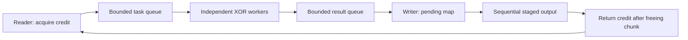

# Architecture and invariants

## Ownership and normal completion



A chunk's vector has exactly one owner. The reader acquires a credit **before**
allocating its vector. Ownership then moves to the task queue, one worker,
the result queue, and finally the writer. The writer returns the credit only
after writing the expected chunk and erasing its vector.

Let `L` be the in-flight limit and `C` be the chunk size. The sum of payload
sizes held across all stages is at most `L × C`; it cannot grow with input size.
The pending map is a subset of those same admitted chunks. Queue capacities
bound each queue independently but do not, by themselves, bound a reorder map.

The reader emits consecutive IDs starting at zero, with exactly one terminal
chunk. A zero-byte input emits ID zero with an empty vector and `is_last=true`.
The reader's final short read, observed initial file size, and final EOF probe
guard against truncation/growth. The caller must keep input contents stable.

The producer closes task admission only after a complete read. Workers drain
tasks and each report completion under a mutex. The last worker closes the result
queue. The writer drains results and validates chunk ID, exact size, terminal
flag, duplicate IDs, total bytes, and total chunks before publication.

## Why the memory bound does not deadlock

The writer continues consuming results even if the expected chunk is absent.
It does not stop draining because the pending map reached an arbitrary size.
A delayed earliest chunk already holds a credit, so admission pressure cannot
prevent its worker from finishing. Draining the result queue eventually lets
that worker publish its result. Sequential writing then releases credits.

Restricting only the pending map and stopping result consumption can deadlock:
the earliest worker may be blocked behind a full result queue. The shared
admission window avoids that design.

## Thread safety

Only the reader thread operates the input stream. The calling thread is the
sole writer and sole owner of the pending map and statistics. Workers mutate
only chunks they own; key bytes are immutable. Queue state, window credits,
first exception, and active-worker count each have an explicit mutex.
Condition-variable predicates are checked while holding their mutex, including
after spurious wakeups. No spinlocks or periodic polling are used by the core.

ThreadPool owns every std::thread and joins it. During partial thread creation
failure, its error callback cancels blocked work before joining started threads.
The pipeline also catches allocation or argument-copy errors occurring before
a ThreadPool constructor can run, cancels first, and then joins existing pools.

## Error and shutdown protocol

Queue `shutdown()` refuses further pushes and allows existing items to drain.
Queue `shutdown(true)` also discards pending items. Both operations wake all
blocked push/pop calls. Failed pushes preserve the caller's object.

Any reader, worker, writer, or startup exception enters the shared nonthrowing
failure callback. It stores the first exception under a mutex, cancels the credit
window, and discards/closes both queues. Thus a blocked reader, blocked result
producer, and idle worker all wake. In-progress chunk transformation may finish
before cancellation takes effect; no asynchronously interrupted mutation occurs.
All pools are joined before the first error is rethrown.

OutputTransaction owns its stream and staging directory. It flushes/closes only
after a fully successful pipeline, then publishes with create_hard_link.
An already-created destination prevents publication atomically. Its destructor
removes private staging files on normal return and exception unwinding.

## Rolling XOR definition

For absolute byte position `p` and a nonempty binary key of length `K`:

```text
mask(p) = (key[p mod K] + floor(p / K)) mod 256
output[p] = input[p] XOR mask(p)
chunk_start = chunk_id × chunk_size
```

Offset multiplication is checked for 64-bit overflow. A worker computes its
starting key index and rolling byte once. The inner byte loop increments these
counters without per-byte division. Applying the same mask again restores
the original bytes. Partitioning and worker scheduling never affect the mask.

The mask repeats after 256 × K bytes. Known plaintext reveals the keystream;
reusing keys reveals relations between plaintexts; arbitrary ciphertext changes
produce corresponding plaintext changes. There is no authentication or
wrong-key/corruption detection. This algorithm is deliberately limited to the
baseline requested in the task.
